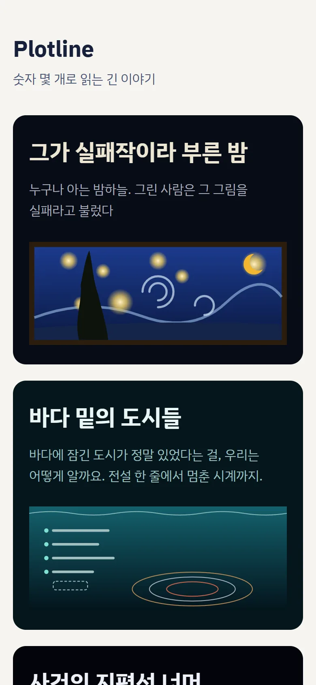
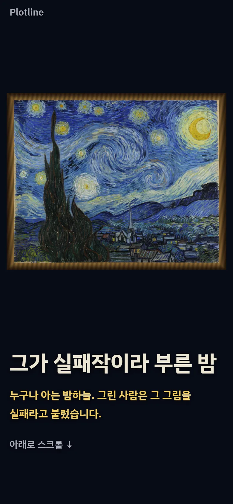
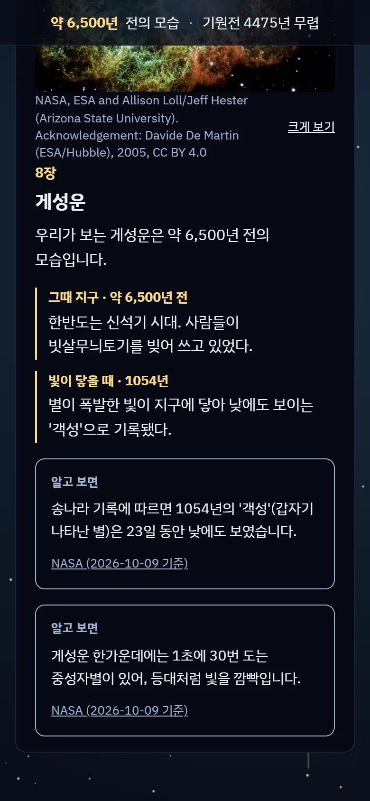
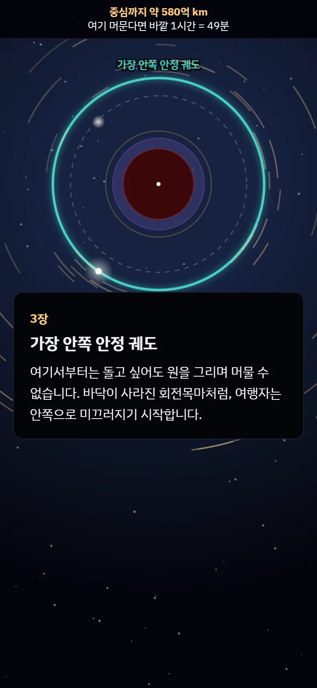
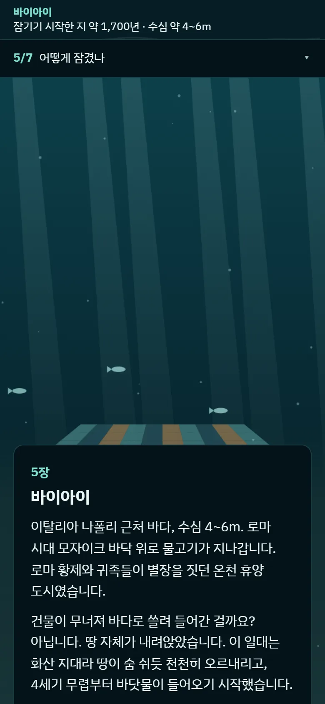
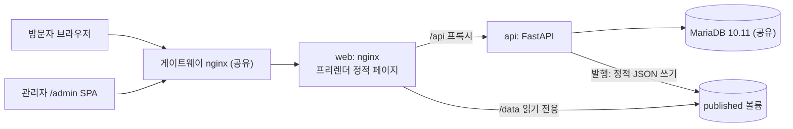

# Plotline

사실과 데이터로 엮은 이야기를, 휴대폰에서 스크롤하며 읽는 인터랙티브 스토리 웹

<table>
  <tr>
    <td></td>
    <td></td>
    <td></td>
  </tr>
  <tr>
    <td align="center">첫 화면</td>
    <td align="center">5편 표지</td>
    <td align="center">2편 8장</td>
  </tr>
  <tr>
    <td></td>
    <td></td>
    <td></td>
  </tr>
  <tr>
    <td align="center">3편 3장</td>
    <td align="center">4편 5장</td>
    <td></td>
  </tr>
</table>

## 바로 보기

운영 주소: https://plotline.duckdns.org (휴대폰으로 여는 것을 기준으로 만들었다)

| 편 | 이야기 | 한 줄 소개 |
| --- | --- | --- |
| 1 | [원소는 언제 발견됐을까](https://plotline.duckdns.org/stories/element-discovery) | 고대부터 오늘까지, 주기율표가 채워진 순서를 따라갑니다. |
| 2 | [밤하늘은 과거다](https://plotline.duckdns.org/stories/light-age) | 달에서 M87 블랙홀까지, 지금 보는 빛이 언제 떠났는지 거슬러 오릅니다. |
| 3 | [사건의 지평선 너머](https://plotline.duckdns.org/stories/black-hole) | M87 블랙홀의 그림자 안으로 떨어진 여행자를 따라, 블랙홀의 경계를 하나씩 지나갑니다. |
| 4 | [바다 밑의 도시들](https://plotline.duckdns.org/stories/sunken-cities) | 바다에 잠긴 도시가 정말 있었다는 걸, 우리는 어떻게 알까요. 전설 한 줄에서 멈춘 시계까지. |
| 5 | [그가 실패작이라 부른 밤](https://plotline.duckdns.org/stories/starry-night) | 누구나 아는 밤하늘. 그린 사람은 그 그림을 실패라고 불렀습니다. |

## 무엇이 다른가

- 화면을 내리면 뒤의 장면이 이야기를 따라 움직인다. 주기율표가 채워지고, 빛이 거슬러 오르고, 블랙홀 쪽으로 떨어지고, 그림 속으로 다가간다.
- 본문에 나오는 숫자와 날짜는 데이터와 자동으로 대조한다. 어긋나면 그 문단을 화면에서 숨긴다.
- 데이터 줄마다 출처가 붙는다. 외부 자료는 출처 주소와 기준 날짜를 함께 달고, 직접 쓴 줄은 "직접 작성"으로 표시한다.
- 출처는 각 이야기 끝 출처 절에서 펼쳐 볼 수 있다.

---

아래는 개발자를 위한 내용이다.

## 구조



- 공개 화면: SvelteKit을 adapter-static으로 빌드해 이야기 페이지를 프리렌더한다. 운영에는 Node 프로세스가 없다(D-07).
- 관리자: 같은 SvelteKit 앱의 `/admin`이 SPA로 동작한다. 단일 계정 · 서명된 세션 쿠키로 인증한다(D-20).
- API: FastAPI가 데이터 입력 · 검증 · 승인 · 판 확정 · 이야기 발행을 맡는다(D-01).
- DB: 서버에 이미 있는 공유 MariaDB 10.11을 재사용한다(D-03). 주제별 테이블 대신 공통 테이블과 JSON 칸을 쓰고, 형식 검사는 앱 검증 엔진이 한다(D-17).
- 발행: API가 정적 JSON을 공유 볼륨에 쓰고 web이 `/data/`로 서빙한다. 데이터 변경에 배포가 필요 없다(D-14).
- 운영 컨테이너는 web · api 두 개다(D-13).

## 데이터 흐름

1. 붙여넣기 — 출처를 조사해 정리한 데이터 묶음(JSON: 필드 정의 + 줄)을 관리자 화면에 붙여넣는다(D-27).
2. 검증 — 저장 전에 미리보기로 대상 · 구조 변화 · 줄 분류를 확인한다. 출처 유형이 없는 줄, 출처 주소가 없는 외부 자료 줄은 승인되지 않는다(D-18, D-28).
3. 새 줄 승인 — 오류 없는 대기 줄을 일괄 승인하거나 줄별로 반려한다. 값이 바뀌지 않은 줄은 저장하지 않는다(D-28).
4. 판 확정 — 승인된 줄로 번호가 붙은 판 파일(`v{n}.json`)을 만든다. 이미 만든 판은 덮어쓰지 않아 이력이 남는다(D-29, D-30, D-38).
5. 이야기 등록 — 백엔드 registry가 정한 이야기에 대해 묶음별 판 · 제목 · 요약을 고른다(D-37).
6. 미리보기 — 공개 페이지와 같은 컴포넌트에 고른 판을 넣어 본다(D-37).
7. 발행 — 이야기 파일과 목록(`index.json`)을 교체한다. 되돌리기는 이전 판 내용으로 새 판을 발행하는 방식이다(D-37).

## 이야기 한 편의 구성

여러 이야기가 함께 쓰는 코드는 [`frontend/src/lib/story/`](frontend/src/lib/story/), 한 이야기 전용 코드는 `frontend/src/lib/stories/<이야기>/`에 둔다(D-26). 5편의 예:

```text
frontend/src/lib/stories/starry-night/
  StarryNightPage.svelte    표지 → 장 → 끝맺음 → 출처 절
  chapters.ts               장별 문구와 그 문구가 기대는 사실(claims)
  storyChecks.ts            claims ↔ 데이터 대조(순수 함수)
  starryStory.ts            판 데이터 불러오기 · 문구 대조 결과
  starryData.ts             판 JSON → 사건 날짜 지도(순수 함수)
  StarryBackground.svelte   배경 캔버스(동작 줄이기면 정지 그림)
  starryScene.ts            장 · 진행도 → 카메라 자세(순수 함수, 단위 테스트)
  starryRenderer.ts         WebGL2 렌더러(starryShaders.ts)
  CoverPreview.svelte       첫 화면 표지 그림
  starry-night.images.json  그림 출처 · 라이선스
  theme.css
```

이야기를 하나 추가할 때는 이 폴더와 함께 `frontend/src/routes/stories/<이야기>/`, [`registry.ts`](frontend/src/lib/stories/registry.ts), [`covers.ts`](frontend/src/lib/stories/covers.ts), 백엔드 [`registry.py`](backend/app/admin_stories/registry.py)에 등록한다.

### 문구 대조(claims)

문구는 코드에 두고, 문구가 기대는 사실을 옆에 적는다. 아래는 5편 1장이다([`chapters.ts`](frontend/src/lib/stories/starry-night/chapters.ts)).

```ts
cards: [[
  '… 1889년 6월, 서른여섯 살의 빈센트 반 고흐가 그린 그림입니다.',
  …
]],
claims: [
  date('painted', 1889, 6, null),               // 그린 때가 1889년 6월인가
  { kind: 'age', event: 'painted', years: 36 }, // 출생일 기준 그때 만 36세인가
  { kind: 'present', event: 'moma_acquired' }   // 데이터에 그 사건이 있는가
]
```

[`storyChecks.ts`](frontend/src/lib/stories/starry-night/storyChecks.ts)가 실제 판 데이터로 각 claim을 계산하고, 하나라도 어긋나면 그 장의 카드 문단을 숨긴다. 같은 대조를 [`storyChecks.test.ts`](frontend/src/lib/stories/storyChecks.test.ts)로 PR CI에서도 돌린다(D-34).

## 기술 선택과 이유

| 결정 | 이유 |
| --- | --- |
| D-02 프론트 SvelteKit · Svelte 5 | 스크롤리텔링 참고 자산이 SvelteKit에 많고, 관리자 SPA까지 한 앱으로 처리할 수 있다 |
| D-07 adapter-static · 발행 시 정적 JSON | 운영에 Node 프로세스가 필요 없어 RAM과 관리 대상이 준다 |
| D-03 공유 MariaDB 재사용 | 단일 서버의 RAM을 아낀다 |
| D-17 공통 테이블 + 필드 정의 JSON | 새 이야기마다 ALTER · 코드 수정 없이 정의 입력만으로 데이터를 추가한다 |
| D-29 판 파일 불변 · 기록과 쓰기를 한 동작으로 | 이야기가 판 번호로 참조하므로 공개 파일이 바뀌면 안 되고, 재시도가 안전해야 한다 |
| D-34 문구 대조를 node:test로 PR CI에서 | 수동 실행에 기대지 않고 타입체크 · 빌드와 같은 흐름에서 실제 판을 검사한다 |
| D-42 5편 WebGL2 직접 구현 | three.js 같은 렌더링 라이브러리는 런타임 의존성이 늘고, 필요한 기능은 셰이더 몇 개뿐이다 |

전체 결정은 [`docs/architecture-baseline/decisions.md`](docs/architecture-baseline/decisions.md)에 있다.

## 기술 스택

lock 파일 · `pyproject.toml` · Dockerfile 기준 버전이다.

| 영역 | 이름 | 버전 |
| --- | --- | --- |
| 프론트 | Node | 24.21.0 |
| 프론트 | pnpm | 12.10.1 |
| 프론트 | SvelteKit | 3.0.1 |
| 프론트 | Svelte | 5.57.2 |
| 프론트 | Vite | 8.3.3 |
| 프론트 | TypeScript | 6.0.3 |
| 백엔드 | Python | 3.14.8 |
| 백엔드 | uv | 0.12.23 |
| 백엔드 | FastAPI | 0.142.4 |
| 백엔드 | SQLAlchemy | 2.1.4 |
| 백엔드 | Alembic | 1.20.0 |
| DB | MariaDB | 10.11 |
| 서빙 | nginx | 1.30.5 |

## 검증

- 자동 테스트(2026-10-12 로컬 실행): 프론트 `node --test` 131개 통과, 백엔드 `pytest` 416개 통과. 백엔드 DB 테스트는 테스트 전용 MariaDB 컨테이너에서 테스트마다 트랜잭션을 롤백한다(D-24).
- PR CI([`pr-ci.yml`](.github/workflows/pr-ci.yml)): frontend 잡(타입체크 · lint · 단위 테스트 · 빌드)과 backend 잡(MariaDB 10.11 서비스 + pytest)을 항상 둘 다 돌린다(D-12). main 규칙에서 두 잡이 필수 체크이고, PR을 거쳐 Squash로만 머지한다.
- 화면 확인: CI에 E2E는 없다. 대신 작업마다 Playwright로 휴대폰 크기(390px) · CPU 감속(4배)에서 초당 그리기 횟수 · 콘솔 오류 · 가로 넘침 · 동작 줄이기 설정을 측정하고, 문구가 숨겨지지 않았는지 확인한다.

## 개발 프로세스

- 작업 단위: 한 번에 하나의 STEP 지시서로 일한다. 이 README가 STEP 101이다.
- 결정 기록: 갈림길에서 고른 이유만 [`decisions.md`](docs/architecture-baseline/decisions.md)에 남긴다. 고치지 않고 덧붙이기만 하며, 현재 42건(D-01~D-42)이다.
- 시각 시제품 관문: 새 이야기는 대표 장면 시제품을 먼저 만들어 휴대폰에서 판정받기 전에는 본 구현을 시작하지 않는다. 판정을 통과하지 못한 이야기는 공개하지 않고 폐기한다. 타이태닉의 마지막 밤을 다룬 6편이 시제품 3차와 구현까지 갔다가 이렇게 폐기됐다.
- AI 역할 분담: 기획 · 설계 · 지시서 작성은 Claude(채팅), 구현과 git 작업은 Claude Code(지시서를 받아 수행하는 runner 에이전트)가 한다. 사람(zslab)은 방향을 정하고, 화면과 결과를 판정하고, 머지한다.
- 위험도별 외부 검토: A(인증 · 상태 전이 · 파괴적 마이그레이션 · 파일 쓰기 등)는 외부 검토 필수, B(조회 API · 추가형 변경)는 선택, C(프론트 전용 · 문서 · 설정)는 생략한다. 외부 검토는 구현과 분리된 채팅에서 하고, 다른 회사 모델(ChatGPT)로도 교차 검토한다. 결과는 결정 기록에 "지적 N건 중 수용 N"으로 남긴다(예: D-22, D-30, D-37).

## 배포 · 운영

- main에 머지되면 [`deploy.yml`](.github/workflows/deploy.yml)이 바뀐 영역(`frontend/` 또는 `backend/`)의 이미지만 빌드해 ghcr.io에 올린다. 태그는 `sha-<7자>`와 `latest`다.
- 이어서 SSH로 서버의 [`scripts/deploy.sh`](scripts/deploy.sh)를 불러 이미지를 받고 재기동한다. 새 api를 띄우기 전에 마이그레이션을 1회 적용하고, 실패하면 기존 컨테이너를 유지한다(D-19).
- 롤백은 `.env`의 `WEB_IMAGE_TAG` · `API_IMAGE_TAG`에 이전 `sha-` 태그를 지정한다.
- 단일 서버에서 다른 서비스와 공유 MariaDB · 게이트웨이 nginx를 함께 쓴다(D-03, D-08). 스테이징 서버는 두지 않는다(D-39).

## 로컬 실행

Docker Desktop이 필요하다.

1. [`.env.example`](.env.example)을 `.env`로 복사하고 값을 채운다. 시크릿 항목과 관리자 비밀번호 해시 만드는 법은 파일 주석에 있다.
2. 기동 · 마이그레이션

   ```sh
   docker compose up -d
   docker compose exec backend uv run alembic upgrade head
   ```

   프론트 개발 서버는 http://127.0.0.1:5173 이고, API 상태는 http://127.0.0.1:8000/api/health 로 확인한다.

3. 테스트 · 점검 · 빌드

   ```sh
   docker compose exec frontend node --test "src/**/*.test.ts"
   docker compose exec backend uv run pytest
   docker compose exec frontend pnpm check
   docker compose exec frontend pnpm lint
   docker compose exec frontend pnpm build
   ```

4. 중지: `docker compose down`

## 데이터 · 이미지 출처

- 이야기별 데이터 출처(기준 날짜 포함)와 문구 출처는 각 이야기 끝 출처 절에 있다.
- 이야기 속 이미지는 퍼블릭 도메인 · CC0 · CC BY 4.0만 쓰고, 그림 아래와 출처 절에 크레디트 · 라이선스를 표시한다(D-32). 이미지별 출처는 각 이야기 폴더의 `*.images.json`에 있다.
- 5편 그림: 빈센트 반 고흐, The Starry Night(1889), Museum of Modern Art 소장 — 퍼블릭 도메인, 위키미디어 커먼즈(Google Arts & Culture)에서 받았다.
- 5편 깊이 텍스처: Depth Anything V2 Small(Apache-2.0)로 계산했다.
- 글꼴: IBM Plex Sans KR · IBM Plex Mono(OFL-1.1), `@fontsource` 패키지로 자체 호스팅한다.
